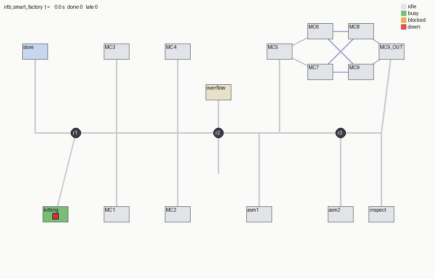
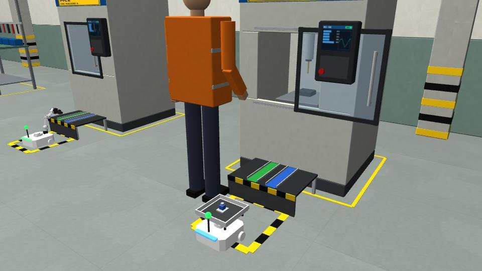
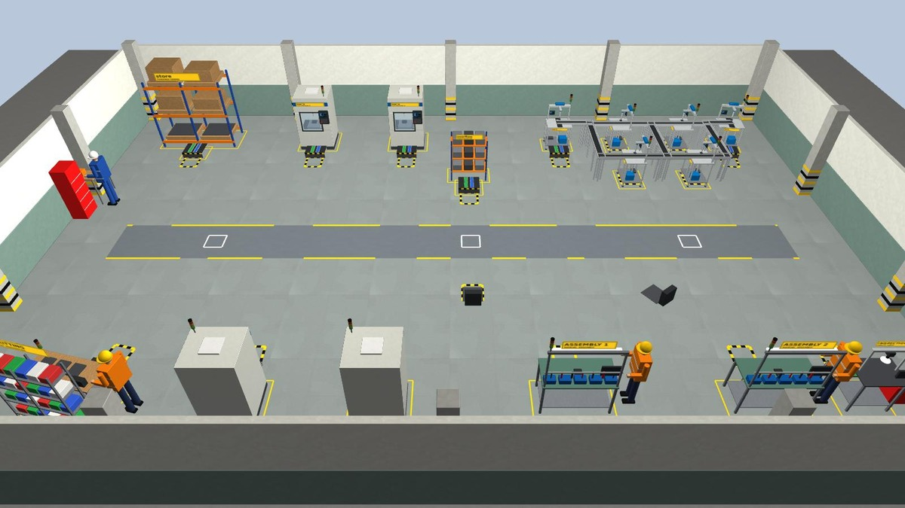
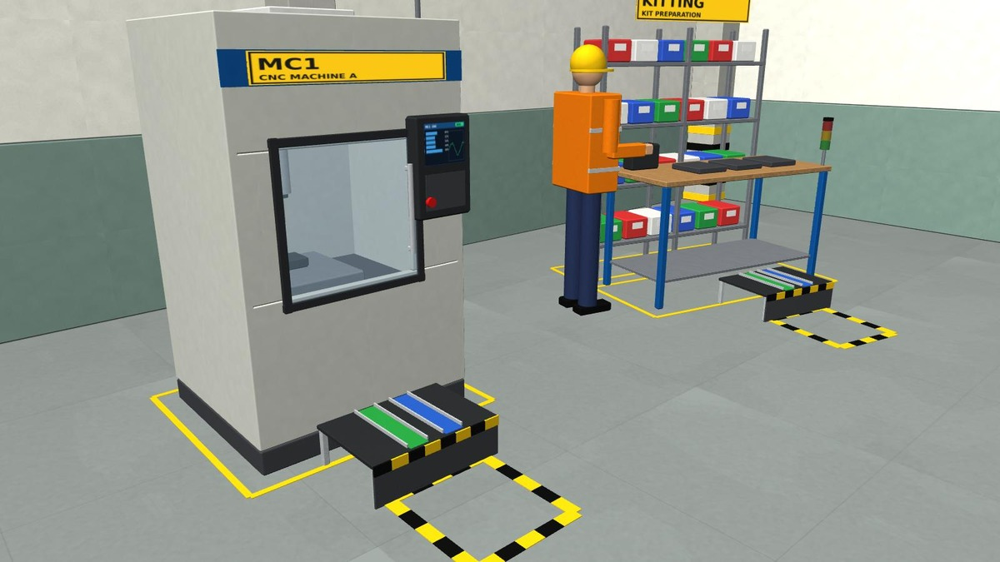
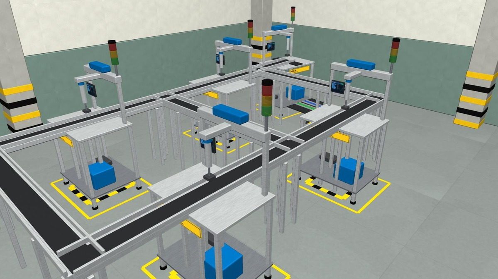
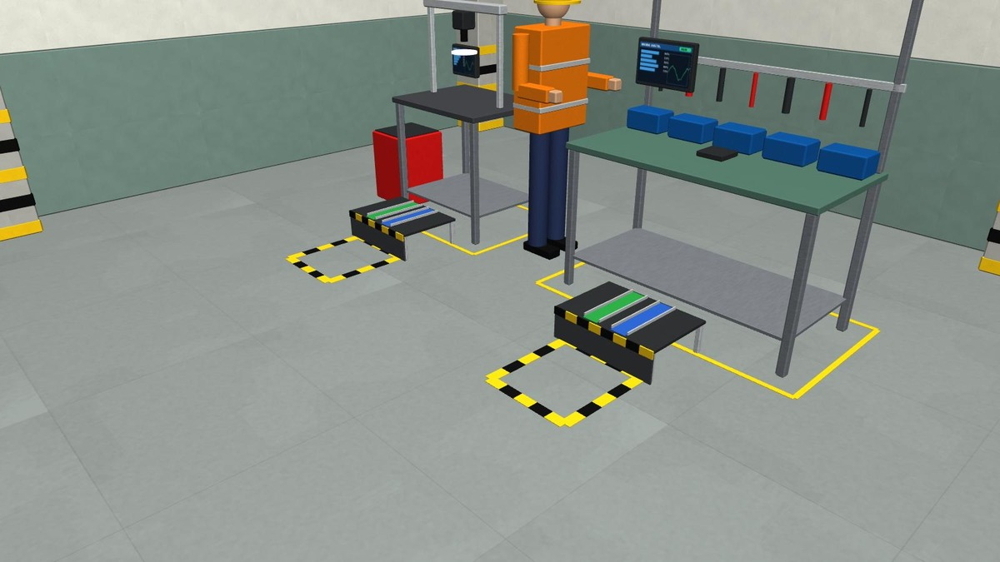
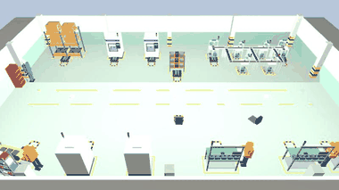
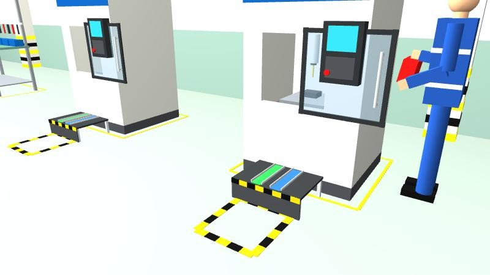
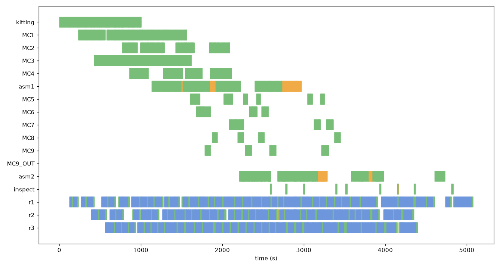

# FactorySim

A smart-factory benchmark for **multi-robot temporal planning, scheduling and reinforcement learning**.

Mobile robots with arms pick, carry and place product trays between kitting, CNC machines, a conveyor line and assembly
stations of a real factory layout (a reference lab inspired by course material on a university smart-factory teaching
lab; not an official model of any facility). Every product follows a route, machines are shared,
buffers are finite, finished trays block their machines, machines break down, inspections reject, orders arrive online and
have deadlines. One simulation core is exposed as a **Gymnasium** env, a **PettingZoo** multi-agent env, a
**PDDL 2.1** temporal planning problem, and an **external-clock** interface for Gazebo / ROS 2 / real robots.



---

## 1. Install

```bash
cd factory_sim
python3 -m venv .venv
source .venv/bin/activate
unset PYTHONPATH                 # only if a ROS installation exports one
pip install -e ".[all]"          # core: numpy, pyyaml, gymnasium, pillow; extras: pettingzoo, ortools, matplotlib, pytest
pytest -q tests                  # 29 tests, ~5 s
```

Core only: `pip install -e .`. Extras: `.[marl]` (PettingZoo), `.[exact]` (OR-Tools CP-SAT), `.[plot]` (Gantt charts).

## 2. Quickstart

```bash
factory-sim run --policy edd --gif run.gif --gantt gantt.png --rfid rfid.json   # one episode of the reference lab
factory-sim families                                                              # scenario families
factory-sim run --config lab_realistic --policy edd                                # every disturbance on (batteries, faults, maintenance, ...)
factory-sim generate                                                              # the benchmark suite 2.0 (train / val / test); --version 1.0 for 1.0
factory-sim bench --suite benchmarks/v2.0 --split test --policy nearest           # evaluate a policy, table per family
factory-sim bench --suite benchmarks/v2.0 --policy examples/my_policy.py:policy   # evaluate your own policy
factory-sim pddl --out pddl_out                                                   # PDDL 2.1 domain + problem
factory-sim solve --instance benchmarks/v2.0/test/exact_S_test_000.json          # lower bound + CP-SAT schedule
```

```python
from factory_sim import Factory, Sim, baselines

sim = Sim(Factory("lab"), seed=0)                    # built-in config name, a .yaml path, or a dict
print(sim.run(baselines.make("edd")))                 # metrics dict

def my_policy(sim, agent, legal):                     # agent: "dispatcher" or a robot "r1", "r2", ...
    return legal[-1]                                  # legal: list of action tuples, ("wait",) always included
Sim(Factory("lab"), seed=0).run(my_policy)
```

```python
import gymnasium as gym, numpy as np, factory_sim

env = gym.make("FactorySim-v0", instance="lab")      # or instance=<benchmark instance dict / .json via scenarios.load>
obs, info = env.reset(seed=0)
while True:
    action = np.random.choice(np.flatnonzero(info["action_mask"]))      # info["agent"] says who decides
    obs, reward, terminated, truncated, info = env.step(action)
    if terminated or truncated:
        print(info["metrics"]); break

aec = factory_sim.aec_env(instance="lab")           # PettingZoo AEC: agents dispatcher, r1, r2, ...
```

`examples/quickstart.py` runs all three.

## 3. The factory model

| Concept | Meaning |
| --- | --- |
| **Station** | `kitting`, `machine`, `assembly`, `inspection`, `port` (process trays), `buffer` (storage), `sink` (finished goods). One tray in process at a time; `slots_in` input slots, `slots_out` output slots. |
| **Product / route** | Ordered steps; a step may list **alternative stations** (`[MC6, MC7]`), a product may have **several routes** (chosen at release). |
| **Rework** | `reject: p` on a station; `rework_to: <station>` sends the tray back to that step, otherwise it is scrapped and re-ordered. |
| **Operators** | Pools (`kitter: 1`, `assembler: 2`); a station with `operator:` needs both the station and a free operator. |
| **Blocking** | A finished tray that cannot leave (output slots full, or conveyor target full) stays on the machine; the machine cannot start the next tray. |
| **Conveyors** | `transfers` move trays between stations without a robot (e.g. the conveyor line MC5 → MC6/MC7 → MC8/MC9 → MC9_OUT). |
| **Robots** | Mobile manipulators carrying one tray; travel on a floor graph at `speed`, with noise `travel_cv`; `pick` / `place` with the arm at a station's dock (`grasp_success`, `place_success`: a failed attempt is retried); optional battery and charger. (`load` / `unload` are accepted as older names.) |
| **Congestion** | `dock_capacity` robots served at a station at once (others queue); travel slows by `slowdown` × other moving robots. |
| **Orders** | Product, arrival (batch or online), due date (`due_factor` × the product's nominal flow time). |
| **Uncertainty** | Every duration is a model: `{fixed: x}`, `{uniform: [a, b]}`, `{normal: [m, sd]}`, `{lognormal: [mean, cv]}`, `{exponential: m}`, `{empirical: [...]}`; machine breakdowns (`mtbf`, `mttr`); inspection rejects. |
| **Machine configurations** | `configs: {standard: {}, as_MC3: {replaces: MC3, time: ...}}`: a configuration either plays the machine's own role or takes over another machine's role (`replaces`), e.g. MC1 re-tooled to do MC3's operation while MC3 is broken. The dispatcher decides `("setup", machine, config)`; the changeover takes `changeover` time, needs the technician and an empty machine. |
| **Maintenance** | `maintenance: {every: busy seconds, duration}` (preventive service when due, after the current job) and `downtime: [[start, duration]]` (planned windows). With `technician: <pool>` one crew does repairs first, then services, then changeovers. |
| **Energy** | `battery: {capacity, per_metre, per_second, per_service, low, reserve, charge_rate, chargers, auto}`: drain while driving, idling and picking; below `low` an idle robot drives itself to the nearest free charger (queues if all are taken) and charges at `charge_rate`; robots never accept tasks they cannot finish and still reach a charger; the policy may also charge earlier (`("charge",)`). |
| **Robot faults** | `robots.fault: {mtbf, mttr}`: a robot stops when it next becomes free (keeping any part it holds) until repaired. |
| **Operator breaks** | `operator_breaks: {assembler: {every, duration, n}}`: n operators of the pool leave for `duration`; their stations wait. |
| **Materials** | `materials: {stock: {PR1: 2}, replenish: {every, qty}}`: an order can be released only if its raw-material kit is in stock. |
| **Conveyor jams** | `conveyor_jams: {prob, clear}`: a transfer jams with `prob` and takes `clear` longer. |
| **Rush orders** | `orders.rush: {prob, due_factor, weight}`: tighter due date and weight in the weighted tardiness and the reward. |
| **Failure** | `deadlock` (nothing can ever happen again), `stalled` (the policy kept waiting with nothing scheduled), `horizon`. |

Each of these is switched by `features:` (`battery`, `robot_faults`, `maintenance`, `reconfiguration`, `breaks`,
`materials`, `jams`, plus `breakdowns`, `rejects`, `stochastic`). `lab.yaml` carries all the specs with the new
features off (the v1 behaviour); `lab_realistic.yaml` (`extends: lab`) turns everything on; `lab_showcase.yaml`
compresses time so that every event happens in a short Gazebo demo. Configs can `extends:` another config.

The reference lab is `factory_sim/configs/lab.yaml`: 4 products (PR1–PR4) with fixed routes, CNC machines MC1/MC2
(type A) and MC3/MC4 (type B), assembly stages 1 and 2, a conveyor line MC5–MC9 with exit MC9_OUT, inspection, an
overflow buffer and 3 TurtleBot3 robots with an OpenMANIPULATOR-X arm (`tb3_manipulator`) that pick, carry and place
every tray. It has **no people**: kitting, assembly and inspection run as timed station processes, and repairs,
services and changeovers (when switched on) need no technician. A human workforce is optional: `lab_realistic.yaml`
and `lab_showcase.yaml` add a kitting operator, two assemblers, a technician crew and operator breaks; tray robots
bring human handlers (`lab_mixed_fleet.yaml`); `lab_v1.yaml` is the FactorySim 1.x lab with its workforce (the 1.x
suites are generated from it). **All times, positions, capacities and probabilities are placeholders**; replace them with measured values for any real facility (`factory_sim.ros.calibrate` fits the robot model from logs).

### Robot types: choose the robots, get their actions

Like picking a robot model in a physics simulator, a config picks **robot types** and then overrides parameters.
The type decides the robot's parameters, how it is programmed, and **which actions exist in the domain**. No
humanoids: every robot is a wheeled TurtleBot3 variant that exists as hardware. The default lab uses arm robots only
and has no people, so Gazebo draws no human figures; configs with a workforce draw their operators, technicians and
handlers (hide them with `people:=false`).

| Type | Robot | Who moves a tray on / off | PDDL actions it adds | ROS 2 interfaces | Gazebo |
| --- | --- | --- | --- | --- | --- |
| `tb3_manipulator` | TurtleBot3 Waffle Pi + OpenMANIPULATOR-X | the robot (arm pick / place, can fail and retry) | `load-machine`, `load-out`, `load-buffer`, `unload`, `unload-buffer`, `unload-sink` | Nav2 `navigate_to_pose`, `cmd_vel`, arm `set_joint_trajectory` | yes |
| `tb3_tray` | TurtleBot3 Waffle Pi with a tray, no arm | a **handler** (person) from an operator pool; the robot waits docked for one | `handover-load-*`, `handover-unload-*` (robot + handler) | Nav2, `cmd_vel` | yes |
| `tb3_burger_tray` | TurtleBot3 Burger with a small tray | a handler | `handover-*` | Nav2, `cmd_vel` | Waffle tray model stands in |
| `custom` (default) | the parameters in the config (FactorySim 1.0 behaviour) | the robot | `load-*` / `unload-*` | as `tb3_manipulator` | yes |


*`lab_mixed_fleet` in Gazebo: a tray robot docked at MC1 with a handler moving its tray; an arm robot works at MC2 behind.*

All robots also `move`, and with batteries `charge`; the Gym / PettingZoo task actions (`pickup`, `deliver`, `move`,
`charge`, `wait`) are the same for every type, the type changes what happens at the station.

```yaml
robots:                                   # one type; the keys next to `type` override it
  type: tb3_tray
  count: 3
---
robots:                                   # a mixed fleet; shared keys (start, parking, battery chargers) sit next to `fleet`
  start: [k2, k5, k8, k4]
  handlers: 2                             # size of the handler pool (`handler_pool`, default `handler`) if `operators` lacks it
  fleet:
    - {type: tb3_manipulator, count: 2}
    - {type: tb3_tray, count: 1, speed: 0.2}
```

`factory-sim robots` lists the types with their parameters and interfaces; `factory-sim robots lab_mixed_fleet` shows a
config's fleet and its PDDL actions (`lab_mixed_fleet.yaml`: 2 arm robots and a tray robot). Handlers are
people: the nearest free one walks over (floor-graph distance / `handler_speed`, 1 m/s) and stays where they worked; a
station can name its own pool (`handler: kitter`), so handovers then compete with that station's work. The PDDL domain is
generated per fleet (`pddl.domain(factory)`): a 1.0 fleet keeps the 1.0 domain text; a mixed fleet gets per-robot
`(load-time ?r)`, `(travel ?r ?a ?b)`, `(self-loading ?r)` / `(handled ?r)` and the `handover-*` actions, which need
`(op-free ?h)` and `(handler-for ?h ?s)` (POPF plans for tray fleets are VAL-valid and execute). To add a type, add an
entry to `factory_sim/robots.py:TYPES` (or `robots.register(...)`); keys not given fall back to the generic robot.
Sketched for later: `roller_amr` (powered roller top, conveyor-height transfers) and `cart_x4` (four trays per trip).

## 4. Decisions

Decision makers are the **robots** and one central **dispatcher**; machines, operators, conveyors and buffers are
resources. The core advances in time to the next moment when some agent must decide and asks one agent at a time.

| Agent | Actions |
| --- | --- |
| `dispatcher` | `("release", job, route)`: start kitting an arrived order on one of its routes (needs its material kit); `("setup", machine, config)`: change a machine's configuration; `("wait",)` |
| robot | `("pickup", job)`: go to the tray and load it; `("deliver", station)`: take the carried tray to an eligible station (or an overflow buffer); `("move", node)`: reposition; `("charge",)`: charge now (opportunity charging; low batteries are charged automatically); `("wait",)` |

Machines serve their queue first-in-first-out (`queue_rule="fifo"`), earliest due date (`"edd"`) or by priorities
set by the policy (`"priority"`, `sim.priority[(job, step)] = value`).

**Gymnasium encoding.** One `Discrete(n)` space for every agent, masked: `0` wait, then pickup per job, deliver per
station, move per target node, charge, release per (job, route), setup per (machine, config). `info["action_mask"]`, `info["agent"]`. Illegal
actions become `wait` with a small penalty (`invalid_action="raise"` to fail instead).
**Observation.** A flat vector (stations, robots, jobs, current agent, time); `env.unwrapped.graph()` gives a graph
(stations, robots, jobs as nodes; typed edges) for GNN policies.
**Reward.** `-(elapsed time) / time_scale - (new tardiness) / time_scale`, and `-fail_penalty` on deadlock / stall.
The return is therefore minus (makespan + total tardiness) / time_scale.

## 5. Time sources and backends

`Sim(..., time_source=...)`:

| Time source | Durations | Used for |
| --- | --- | --- |
| `"sampled"` | drawn from the models (seeded) | training, evaluation |
| `"nominal"` | mean of every model; no breakdowns or rejects | planning, ground truth, debugging |
| `"external"` | reported by a backend: `sim.complete(activity_id, t)`, `sim.advance(t)` | Gazebo, ROS 2, hardware |

The core owns the task-level state (who carries what, where it goes, what each machine holds); a backend owns the
physical state (poses, navigation). `factory_sim/backends.py` documents the loop and `run_external()` is a reference
driver; with nominal durations it reproduces a nominal run exactly (tested).

### Gazebo + ROS 2 (mobile manipulators, Nav2)

`factory_sim/ros/` runs the same core in a 3D Gazebo shop floor generated from the config, with one Nav2 stack and one
arm per robot.



| CNC cell (sign, HMI, sliding door, robot counter) | modular-conveyor line | Assembly |
| --- | --- | --- |
|  |  |  |

Showcase (`lab_showcase`, 3 robots, every disturbance on; time compressed):

| Shop floor: robots with low batteries drive to the chargers, a long MC3 breakdown, re-tooling, maintenance | CNC cell: door shuts while the spindle cuts, robots dock and pick, the technician walks in | Assembly: operators work, leave for breaks and return |
| --- | --- | --- |
|  |  |  |

Full-resolution showcase GIFs (overview, CNC cell, assembly) are attached to the release as assets.

| File | Role |
| --- | --- |
| `world.py` | config → Gazebo world: building with columns, epoxy floor, yellow aisle lines, hatched robot docks, parking boxes; enclosed CNC cells (window, spindle, pendant, stack light); an modular-conveyor line (profile tables, pneumatic press units, valve manifolds, HMIs, belt conveyors along the `transfers`); kitting bench with bin shelving, assembly benches, an inspection booth with camera arch, operators in PPE, a flow rack (buffer), pallet racking (store), a charging station; a low transfer counter (green IN lane, blue OUT lane) at every robot dock. Also writes the Nav2 map rasterised from the same collision footprints, and `layout.json` (dock poses, counter slots, work poses, conveyor paths, stack-light poses, workpiece models) |
| `robot.py` | the robots' top modules, chosen by robot type: an OpenMANIPULATOR-X (real meshes) or a tray deck, each a separate kinematic model pinned to a stock TurtleBot3 Waffle (no collisions, so the lidar sees through it and the robot's physics is untouched); arm IK and pick / place trajectories |
| `factory_node.py` | ROS 2 node: core with `time_source="external"` on the simulation clock. Travel = Nav2 `NavigateToPose` to an approach pose 0.55 m in front of the dock (or to a waiting spot at the aisle if the dock is taken); pick / place = dock in on a straight line, an arm motion, reverse out; the arm motion has with a sampled duration and grasp outcome (failed grasps are reported with `sim.complete(aid, ok=False)` and retried); machines, operators and conveyors run as timers with durations sampled from the config's models; workpieces move with the arm, sit on counters, go inside machines, ride the conveyors and end on the store rack; stack lights show busy (green), blocked (amber), down (red) |
| `animator.py` | everything that moves besides the robots: workpieces glide between counters, machines and the gripper; CNC doors slide shut while machining and the spindle feeds; conveyor-station presses stroke; operators work at their benches and walk out for breaks; the technician walks from the maintenance bay (behind the machine rows) to repairs, services and changeovers; material handlers (orange vests) walk along the aisle to docked tray robots and move the trays; stack lights (green busy, amber blocked, blinking amber setup / service, blinking red down); robot status LEDs (green working, amber low battery, blue charging, red fault); charger lamps |
| `launch/factory_gazebo.launch.py` | writes world, map, robot models and Nav2 parameters, starts gzserver (and gzclient), one namespaced Nav2 + robot per `robotN`, then the factory node |
| `run_gazebo.sh` | the whole thing inside the `factorysim-ros:1.0` Docker image built from `docker/Dockerfile` (ROS 2 Humble, Gazebo 11, Nav2, TurtleBot3 + OpenMANIPULATOR-X meshes, noVNC); runs use ROS domain 42 (`FACTORYSIM_DOMAIN`) |
| `movie.py` | GIFs from the camera frames of a `record:=true` run |
| `teleop.py`, `teleop.sh` | keyboard teleop: select a robot, drive it, jog its arm, or give it factory tasks |
| `media.py` | bevelled meshes, procedural textures, station signs and HMI screens for the world |
| `calibrate.py` | fits the Gym layer's robot model from measured runs: `speed`, `travel_cv`, `pick` / `place` durations, `grasp_success` / `place_success` |

```bash
docker build -t factorysim-ros:1.0 docker/                              # once: ROS 2 Humble, Gazebo 11, Nav2, TurtleBot3, noVNC
python -m factory_sim.ros.world --config lab --out factory_world        # world + map only (no ROS needed)
factory_sim/ros/run_gazebo.sh robots:=2 orders:=2 proc_scale:=0.1 policy:=nearest   # headless test run in Docker
factory_sim/ros/run_gazebo.sh gui:=true robots:=3                        # with the Gazebo window (needs a display / VNC)
factory_sim/ros/run_gazebo.sh record:=true robots:=3                     # also save camera frames to <run>/frames/
factory_sim/ros/run_gazebo.sh instance:=lab_mixed_fleet orders:=4 proc_scale:=0.2   # arm robots + tray robots with handlers
factory_sim/ros/run_gazebo.sh instance:=lab_showcase robots:=3 orders:=5 seed:=1 proc_scale:=0.1 charge_scale:=0.05 disturbances:=true record:=true
                                                                         # every disturbance in one short run
python -m factory_sim.ros.movie ros_runs/<run>                           # frames -> GIFs
python -m factory_sim.ros.calibrate ros_runs/*/result.json               # -> robots: {speed, travel_cv, pick, place, ...}
```

Launch arguments: `instance` (config name or instance .json; its robot types pick the Gazebo models), `robots` (ignored for `fleet:` configs), `orders` (first N, 0 = all), `policy`, `seed`,
`proc_scale` (machine / conveyor time factor for quick tests), `nominal` (mean durations, no grasp failures), `gui`,
`record`, `disturbances` (the core samples breakdowns, robot faults, jams and rejects during the run),
`charge_scale` (charging time factor), `people` (`false`: no human figures are drawn; operators, technicians and
handlers still work in the simulation), `localization` (`truth`: ground-truth localisation, the default; `amcl`: AMCL on the lidar), `out`, `delay`
(seconds before the factory starts). Gazebo runs at roughly 0.5-1x real time on a laptop CPU (software rendering);
`record:=true` adds three cameras and slows it further. `result.json` holds the metrics, the RFID log, every
measured travel and every pick / place (duration, success).

**Keyboard teleop.** While a run is going, `factory_sim/ros/teleop.sh` opens a terminal UI (like
`teleop_twist_keyboard`, but factory-aware) that lists every robot with its mode, phase, battery and cargo:

| Keys | |
| --- | --- |
| `1`-`9` | select a robot |
| `z` / `t` / `v` | its mode: **AUTO** (the policy decides) / **TASK** (you decide: its legal actions are listed — pick up job 3, deliver to MC1, move to k5, charge — `[` `]` to choose, Enter to do it; the robot drives, docks and picks / places by itself) / **DRIVE** (you drive it: the factory gives it no work until you hand it back; it is then re-localised to the nearest aisle node and the distance is charged to its battery) |
| `w` `x` `a` `d` `s` `space` | DRIVE: faster / slower / turn left / turn right / stop / e-stop |
| `j` `l` `i` `k` `u` `o` `n` `m` `g` `h` `c` | DRIVE: arm base, shoulder, elbow, wrist, gripper open / close, home pose, carry pose |

Start with `gui:=true` to watch it in the browser (`http://localhost:6081/vnc.html`), and with
`teleop_mode:=task` to put every robot under your control from the start. The node takes the commands on
`/factory_sim/teleop` (JSON) and publishes `/factory_sim/status`, so other tools (a joystick, a web UI) can drive it too.

On a native ROS 2 Humble install: `export PYTHONPATH=<repo>/factory_sim` and
`ros2 launch factory_sim/ros/launch/factory_gazebo.launch.py ...`. On real robots, run Nav2 on each TurtleBot in
namespaces `robot1`, `robot2`, … with the lab map, and start `python3 -m factory_sim.ros.factory_node` (without
`use_sim_time`); the dock poses come from the same config.

## 6. PDDL 2.1

`factory_sim.pddl.export(sim)` writes the **current** state (time shifted to 0) as a temporal planning problem;
`factory_sim.pddl.domain(factory)` is the domain (`pddl.DOMAIN` for one-type arm fleets; mixed fleets add the
`handover-*` actions, see *Robot types*). Durative actions keep resources explicit with at-start / over-all / at-end
conditions: `move`, `load-*`, `unload*` hold a robot; `process` holds a machine **and** an operator (stations without
operators get a private one) and leaves the tray `holding` the machine (blocking) until `to-out`, `convey` or a
robot load; `release` starts kitting. Processing and conveyors need no robot, so they overlap with transport.
Running activities become timed initial literals. The planning view is nominal and deterministic: breakdowns,
rejects, dock queues and congestion are execution-time events.

```python
from factory_sim import pddl
pddl.write(sim, "domain.pddl", "problem.pddl")
# run any PDDL 2.1 planner, e.g. popf domain.pddl problem.pddl > plan.txt ; validate with VAL
sim.run(pddl.PlanPolicy(sim, open("plan.txt").read()))          # execute the plan's releases, pickups and deliveries
```

Tested: POPF plans on exported problems (arm fleets and tray fleets with handovers) are VAL-valid and execute in the simulator.

## 7. The benchmark

The suite is **factorysim-2.0** (`factory-sim generate`), on the people-free reference lab; the one-page
description and reporting protocol are in [BENCHMARK.md](BENCHMARK.md). `factory-sim verify --suite benchmarks/v2.0`
checks that your installed code reproduces the stored ground truth (each instance records the code version that made it).
The 1.x suites (`--version 1.0` / `1.1`) regenerate exactly from `lab_v1.yaml`, the lab with a human workforce.

Difficulty is defined by **scenario dimensions**, not only by size:

| Dimension | Settings |
| --- | --- |
| routing | fixed / alternative machines / alternative routes |
| contention | low (mixed products) / medium / high (products sharing machines) |
| uncertainty | deterministic / stochastic / high (2× CV) |
| reliability | none / breakdowns |
| buffers | unlimited / finite / tight (no output slots, no overflow buffer: deadlock-prone) |
| arrivals | batch / online |
| quality | none / rework / scrap |
| congestion | none / docks / high |
| deadlines | loose / tight / infeasible / rush |
| energy | none / battery (random initial charge, auto-charging) |
| robot_reliability | none / faults |
| maintenance | none / preventive (services, a planned MC5 window, technician crew) |
| flexibility | fixed / reconfigurable (MC1 ↔ MC3, MC2 ↔ MC4 roles) |
| workforce | full / breaks |
| materials | unlimited / shortage |
| conveyors | smooth / jams |
| fleet (1.1) | arm (all `tb3_manipulator`) / tray (`tb3_tray`, handlers) / mixed (arm + tray + Burger) |

Families that need people (`breaks`, `realistic`, `tray_fleet`, `mixed_fleet`) are not in suite 2.0; generated by name
on the default lab, they get the workforce (operators, technician, breaks) added.

**Families** fix some dimensions (`factory-sim families`): `base`, `independent`, `bottleneck`, `flexible`,
`alt_machines`, `congested`, `breakdowns`, `online`, `blocking`, `quality`, `scrap`, `noisy`, `tight`, `exact`,
`infeasible`, `full` (suite v1) and `charging`, `robot_faults`, `maintenance`, `reconfig`, `breaks`, `shortage`, `jams`,
`rush`, `realistic` (added in suite v2; `realistic` turns every disturbance on), and `tray_fleet`, `mixed_fleet`
(suite 1.1, `factory-sim generate --version 1.1`; the 1.0 instances are unchanged), and `disturbed` (suite 2.0: every
disturbance that involves no people). **Sizes**: S (2 robots, 4 orders), M (3, 8), L (4, 14). **Splits**: train (S, M), val (S, M),
test (M, L, larger than training). Suites v1 and v2: 50 / 10 / 10 instances per family and size, plus `exact` (S).
Ground truth (CP-SAT, PDDL) models the machines' initial configurations and ignores energy, faults, maintenance,
breaks and shortages, so for the new families it is a relaxation (bounds stay valid).

**Hard suite (3.0, `SUITE_HARD`): lane traffic.** Families `hard_base`, `hard_bottleneck` (high contention),
`hard_blocking` (no output slots, no buffer), `hard_flexible` (alternative routes), `hard_online` (online orders, tight
due dates), `hard_rush` (rush orders), `hard_full` (contention, alternative routes, online orders, tight due dates,
high duration noise). All have **lane traffic** and **due dates from the workload** (`due: load`: loose = one due date
for all at 1.2 x the reference makespan, tight = staggered from 0.35 to 1.15 x it, rush orders get half the slack).
Sizes S, M, L on the lab and, for testing, plants of 2, 3, 4 production lines (`layouts.plant`): XL (6 robots, 24
orders), XXL (8, 36), XXXL (12, 56). Train S-L, test M-XXXL. Only features the PDDL model also has, so the same
instance runs here and as PDDL (`factory_test/make_data.py --suite hard` exports it with hard deadlines).

**Lane traffic** (`traffic: {mode: lanes}`, dimension `traffic`). The corridor nodes are *junctions* that hold one
robot at a time; docks, chargers, dead ends and `bays` are *pockets* that hold any number. A robot drives edge by
edge (`hop` activities), reserves the next junction before it enters and keeps the one it leaves until it arrives,
so robots cannot pass each other in a corridor: they queue behind each other and meet head-on. An idle robot on a
junction that another robot needs moves into a bay; a cycle of robots waiting for each other is broken by the one
with the lowest priority (a bay to back into, empty before carrying, then by name) backing into a bay (`stats`:
`yields`, `parks`, `traffic_wait`). The PDDL domain becomes `factorysim-lanes`: `move` (into a pocket) and `move-j`
(into a free junction, `node-free`) along `link`ed nodes. Traffic needs simulated time (not the external clock).
**Plants** (`layouts.plant(lines)`): line i is a copy of the lab cell (suffix `_L<i>`); cross aisles at k1, k5, k9 make
intersections; each line has its own kitting, the store is on line 0; a route step can use any line's station.

**Ground truth per instance** (`instance["ground_truth"]`):
- `lower_bound`: max of per-order flow, per-machine load, robot transport work / robots, operator load
  (and the CP-SAT bound when solved);
- `reference_makespan`: best of the FIFO / EDD / nearest rules in nominal mode;
- `cpsat` (family `exact`): optimal schedule of the nominal model with machines, operators, robot assignment and
  robot routing (`exact: true` when the instance has no finite buffers, dock limits or congestion; otherwise a
  relaxation whose bound is still valid). CP-SAT schedules executed in the simulator are within ~3 % of their
  optimum (tested);
- `infeasible_deadlines`: some due date is earlier than that order's own minimum flow time.

**Reporting (recommended).** For each family and size of the test split: success rate, deadlock / stall rate,
makespan / lower bound, makespan / reference, on-time rate, total tardiness, decision time, over 3 seeds per
instance (`factory-sim bench` writes all of these to a JSONL file and prints the table). Report the exact family's
gap to the CP-SAT optimum separately.

### Baseline results (suite 2.0, test split)

| policy | success | makespan / best-known | on-time |
| --- | --- | --- | --- |
| nearest | 100% | 1.051 | 70% |
| mwkr | 100% | 1.088 | 66% |
| cr | 100% | 1.096 | 66% |
| fifo | 99% | 1.122 | 68% |
| edd | 99% | 1.121 | 68% |
| spt | 99% | 1.129 | 68% |
| random | 93% | 4.163 | 0% |
| cpsat (open-loop, 10 s) | `exact`: 100%, 1.09; `base` / `bottleneck` M / L: 12–17% (few schedules found within 10 s) | | |

Per-family results: [docs/baselines_v2.0.md](docs/baselines_v2.0.md). Without people most families score as on the
1.x lab (operators rarely limited throughput); `maintenance` improves, as services no longer wait for one technician.

### Baseline results (suite 1.0, test split, the 1.x lab with its workforce)

| policy | success | makespan / best-known | on-time |
| --- | --- | --- | --- |
| nearest | 100% | 1.086 | 66% |
| mwkr | 100% | 1.118 | 62% |
| cr | 100% | 1.128 | 62% |
| fifo | 99% | 1.149 | 64% |
| edd | 99% | 1.152 | 64% |
| spt | 99% | 1.160 | 64% |
| random | 94% | 4.122 | 0% |
| cpsat (open-loop, 10 s) | `exact`: 100%, 1.08; M / L: no schedule found within 10 s | | |

Per-family results: [docs/baselines_v1.0.md](docs/baselines_v1.0.md). FIFO and EDD coincide on most families because
machine queues hold one tray and batch due dates follow nominal flow times. `best_known` comes from nominal runs
without disturbances, so it is not a bound for stochastic runs. The analytic lower bound is loose (≈2.6× on average);
the test split's M instances also carry a CP-SAT relaxation bound, L instances only the analytic one.

## 8. Configuration reference

```yaml
name: my_factory
nodes: {k1: [x, y], MC1: [x, y], ...}            # floor graph (metres); a station docks at the node of its name
edges: [[k1, MC1], ...]                          # corridors; travel uses shortest paths
robots: {type: tb3_manipulator, count: 3, start: [k1, k2], parking: [k1], battery: null}   # type values; override any of
         # speed, travel_cv, pick, place, grasp_success, place_success (failed grasps / places are retried)
         # or `fleet: [{type: tb3_manipulator, count: 2}, {type: tb3_tray, count: 1}]` (tray robots need handlers)
congestion: {dock_capacity: 1, slowdown: 0.1}
traffic: {mode: lanes, bays: [...], junctions: [...], yield_after: 120}   # optional; default junctions: corridor nodes
operators: {kitter: 1, assembler: 2}            # optional (none in the default lab); stations name a pool with `operator:`
stations:
  MC1: {kind: machine, slots_in: 1, slots_out: 1, time: {lognormal: [300, 0.1]}, tag: MC1, breakdown: {mtbf: 14400, mttr: {lognormal: [600, 0.5]}}}
  inspect: {kind: inspection, time: {fixed: 20}, reject: 0.05, rework_to: asm2}
  store: {kind: sink}
transfers: [[MC5, MC6, {fixed: 15}]]             # conveyors: no robot needed
products:
  PR1: {color: [210, 50, 50], routes: [[kitting, MC1, MC2, asm1, MC5, [MC6, MC7], MC8, MC9_OUT, asm2, inspect]]}
orders: {count: 8, mix: {PR1: 1, PR2: 1}, arrivals: batch, due_factor: 3.0}     # arrivals: batch | {online: mean_gap_s}
features: {stochastic: true, breakdowns: false, rejects: true}
```

Optional per station: `node`, `operator`, `dock_capacity`, `time_by_product: {PR1: <model>}`, `tag` and `log: [IN, OUT]`
(RFID-style events, as the real factory's tracking), `reject`, `rework_to`, `breakdown`. Battery:
`{capacity: metres, charger: node, charge_time: <model>}`.

## 9. Outputs

- **Metrics**: success, failure, makespan, on-time rate, total / max tardiness, mean flow time, station utilisation
  and blocked time, robot utilisation and distance, rejects, scraps, breakdowns, grasp failures, decisions; weighted
  tardiness, rush on-time rate; station down fraction, setups / setup time, services / service time, jams,
  replenishments; robot faults and fault time; handovers and the time tray robots waited for a handler; charges, charging time and minimum battery per robot.
- **RFID log** (`sim.rfid`): `KITTING OUT`, `MC1 IN`, `MC1 OUT`, …, in the factory's own tag names, so simulated and
  real runs can be compared event by event.
- **GIF** (`render.gif`), **Gantt chart** (`render.gantt`), **frames** (`env.render()`); need `Sim(..., record=True)`.



## 10. Layout

```
factory_sim/
  config.py      factory description, validation, floor graph
  robots.py      robot types (parameters, interfaces, the actions each adds), fleet resolution
  timing.py      duration models
  core.py        state, events, rules, decisions, metrics (the single source of truth)
  env.py         Gymnasium + PettingZoo, action codec, observations, graph view
  baselines.py   random, FIFO, EDD, SPT, nearest-job rules
  pddl.py        PDDL 2.1 domain, state export, plan execution
  ground_truth.py lower bounds, CP-SAT schedules, schedule execution
  scenarios.py   dimensions, families, sizes, splits, suite generation (SUITE_HARD: lane traffic, set_dues)
  layouts.py     generated plants of several production lines (the XL-XXXL sizes)
  backends.py    external clock (Gazebo / ROS 2 / hardware)
  ros/           Gazebo world + map generator, mobile manipulator, ROS 2 node, launch, calibration
  render.py      frames, GIFs, Gantt charts
  cli.py         factory-sim command
  configs/lab.yaml
examples/  tests/  docs/
```

## 11. Status

Implemented: everything above, including the 3D Gazebo / ROS 2 layer with mobile manipulators. Verified end to end:
2 robots / 2 orders (makespan 884 s, 28 arm picks / places) and 3 robots / 3 orders recorded (makespan 1268 s, 2 failed
grasps retried, no navigation failures), each through the full lab route (kitting, CNC pair, assembly 1, conveyor line,
assembly 2, inspection, store), with the same RFID trace structure as the Gym layer. Next: the lab's measured times and layout,
calibration from hardware logs, and real machine / RFID signals (MQTT) in place of the machine timers.

## License

MIT. Third-party robot models and software used at runtime (TurtleBot3, OpenMANIPULATOR-X, Nav2, Gazebo): see [NOTICE](NOTICE).
