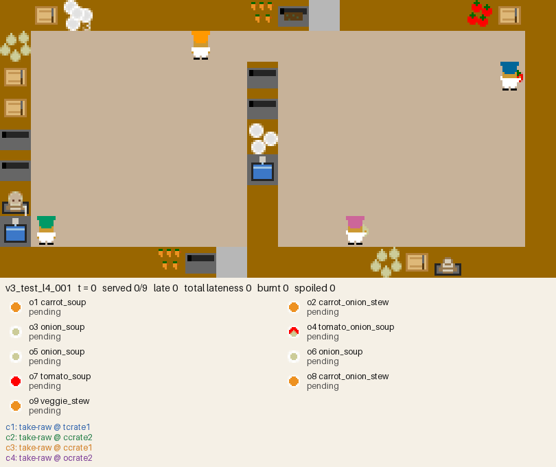
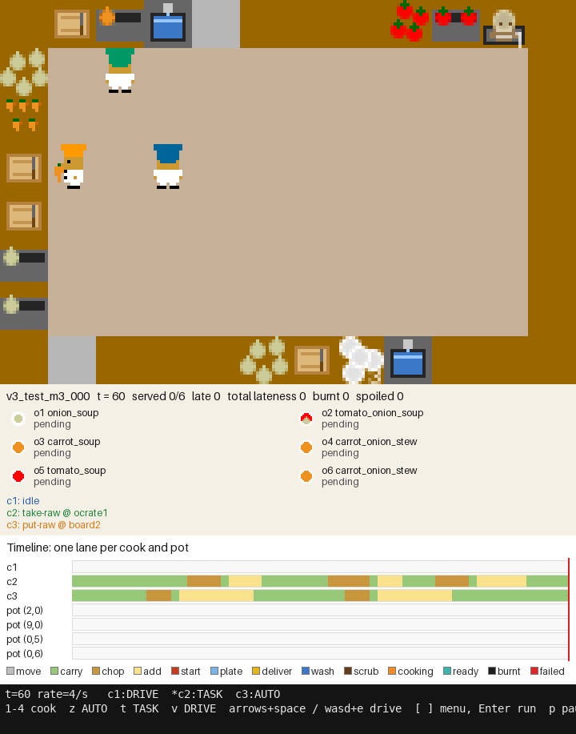
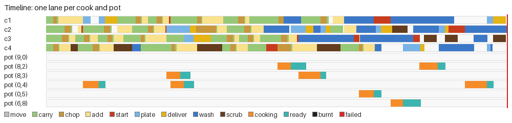

# overcooked-kitchen

A multi-cook **temporal planning, scheduling and reinforcement learning** kitchen benchmark in the style of Overcooked.

One to four cooks share a kitchen: they fetch and chop vegetables, fill pots, wait for soups that cook by themselves
(and burn if left), dish them up, serve diners, and wash the plates and scrub the pots that come back. The kitchen is
described by **our PDDL 2.1 domain** (26 durative actions, `overcooked_kitchen/domain.yaml`) with **several cooks**,
**multi-tasking** (pots cook, soups burn and diners eat while cooks do other work) and **durative actions** as the unit of
decision. The world is **forgiving, the planner model is strict**: the simulator behaves like Overcooked (soups burn,
orders can be served late, a human can do anything the game allows), the PDDL domain has no burning and optional hard
deadlines, and a VAL-valid plan runs in the world with nominal durations without burning or lateness. One core, **two clocks**
(sampled durations, or a grid simulator that really walks and chops), exposed as a Python API, **Gymnasium** envs,
**PettingZoo**, a **PDDL bridge**, a renderer with the **Overcooked-AI sprites** and **human play**.



---

## 1. Install

```bash
cd overcooked_kitchen
python3 -m venv .venv
source .venv/bin/activate
unset PYTHONPATH                 # only if a ROS installation exports one
pip install -e ".[all]"          # core: numpy, pyyaml, gymnasium, pillow; extras: pygame (play), pettingzoo, pytest
pytest -q tests -m "not slow"    # without the ~90 s POPF solves
```

Core only: `pip install -e .`. Extras: `.[play]`, `.[marl]`, `.[dev]`.
POPF, OPTIC and VAL are external binaries (not shipped; POPF is GPL). Put `popf`, `optic-clp`, `Validate`, `Parser` on
`PATH` or set `OVERCOOKED_KITCHEN_POPF`, `OVERCOOKED_KITCHEN_OPTIC`, `OVERCOOKED_KITCHEN_VAL`, `OVERCOOKED_KITCHEN_PARSER`;
the PDDL tests skip without them (the import test also needs `OVERCOOKED_KITCHEN_V2_SOURCE` / `_V3_SOURCE`).

## 2. Quickstart

```bash
overcooked-kitchen run --scenario m02_four_cooks --policy dispatcher --gif run.gif --gantt gantt.png
overcooked-kitchen run --scenario k01_one_soup --policy popf --clock grid     # POPF plan executed on the grid clock
overcooked-kitchen play --scenario m01_three_cooks --cooks 2                    # human play (pygame)
overcooked-kitchen pddl --scenario k02_two_dishes --out pddl_out              # domain.pddl + problem.pddl
overcooked-kitchen solve --scenario k01_one_soup --planner popf               # POPF, checked by VAL
overcooked-kitchen generate --config configs/dataset_multi.yaml --out runs/my_suite --count 5
overcooked-kitchen bench --suite benchmarks/v1 --split v3_val --policy dispatcher
overcooked-kitchen bench --suite benchmarks/v1 --split v2_val --policy examples/my_policy.py:policy
```

Examples: `k01_one_soup`, `k02_two_dishes`, `k03_service_cleanup`, `k04_burn_risk` (one cook), `m01_three_cooks`
(3 cooks, `v3_test_m3_000`), `m02_four_cooks` (4 cooks, `v3_test_l4_001`). `--scenario` also takes a `.yaml` path.

```python
from overcooked_kitchen.core import Sim
from overcooked_kitchen.baselines import make

sim = Sim("m01_three_cooks", clock="sampled", seed=0, noise="default")   # noise=None: nominal durations
print(sim.run(make("dispatcher")))                                      # metrics dict

def my_policy(sim, cook, legal):          # cook: "c1", "c2", ...; legal: tasks, WAIT = ("wait",) always included
    return legal[-1]
Sim("k01_one_soup", noise=None).run(my_policy)
```

```python
import gymnasium as gym, numpy as np, overcooked_kitchen

env = gym.make("OvercookedKitchen-v0", instance="m01_three_cooks")   # "OvercookedKitchenGrid-v0": joint grid actions per step
obs, info = env.reset(seed=0)
while True:
    action = np.random.choice(np.flatnonzero(info["action_mask"]))   # info["agent"] says which cook decides
    obs, reward, terminated, truncated, info = env.step(action)
    if terminated or truncated:
        print(info["metrics"]); break
```

`examples/quickstart.py` runs the simulator, a custom policy, the Gymnasium env and the PDDL export (headless, a few
seconds). `examples/my_policy.py` is a policy file for `bench --policy examples/my_policy.py:policy`.
PettingZoo: `from overcooked_kitchen.env import aec_env`. Env defaults `max_cooks=4`, `max_stations=64`, `max_orders=12`
fit every bundled example and `benchmarks/v1` (at most 4 cooks, 62 stations, 12 orders); `reset()` without a seed draws a
fresh one; `render_mode="rgb_array"` makes `render()` return the frame; `step()` after the end raises (reset first).

## 3. Human play

`overcooked-kitchen play --scenario m01_three_cooks --cooks 2` (grid clock, `--rate` steps per second, `--record out.json`
saves the trajectory). The first `--cooks` cooks start in DRIVE mode, the others follow `--policy` (AUTO).



| Key | Action |
| --- | --- |
| `1`-`4` | select cook |
| `z` / `t` / `v` | AUTO (policy) / TASK (pick a legal task from a menu) / DRIVE (walk it yourself) |
| arrows + space | drive the selected cook (move, interact) |
| `w a s d` + `e` | drive the next driven cook (second player) |
| `[` `]`, Enter | choose a task in TASK mode, run it |
| `p`, `+` / `-`, `r`, `q` | pause, speed, restart, quit |

While a cook is driven the game never ends in a deadlock verdict (a person pausing is not a stuck run); it ends by
success, horizon or quit.

## 4. The kitchen

Layouts use the Overcooked grid characters; digits are cook start tiles.

| Char | Station | Char | Station |
| --- | --- | --- | --- |
| `X` | counter (holds one item) | `O` `T` `C` | onion / tomato / carrot crate |
| `B` | cutting board | `D` | clean-plate rack |
| `P` | pot on a stove | `R` | dirty-plate drop-off |
| `S` | serving window | `W` | sink (washing) |

Flow: take a raw vegetable, chop it on a board, put chopped vegetables into a pot, light the stove (the pot then cooks
by itself), dish the ready soup onto a clean plate, deliver it to the serving window; a diner eats and the dirty plate
returns to the drop-off, is washed at the sink and goes back to the rack; the used pot must be scrubbed. Defaults
(time unit = one grid step, scenario key `sim:` overrides):

| Quantity | Value |
| --- | --- |
| chop strokes | onion 4, tomato 3, carrot 5 |
| cook time | 2 + onion 5 + tomato 3 + carrot 6 per ingredient; at most 4 ingredients per pot |
| burn | a ready soup burns after 20 steps |
| scrub pot / wash plate / diner eats | 4 / 3 / 12 steps |
| walking | one tile per step, BFS shortest path; a turn into a wall costs one step |
| plates | finite (`plates: {clean: n}`), a plate is free again only after eating + washing |
| orders | recipe (ingredient counts), optional `deadline`, `count` |

Tasks are the PDDL catalogue's actions (a cook walks to the station and works there): take-raw, put-raw, take-raw-back, chop,
take-chopped, put-chopped, add-onion / add-tomato / add-carrot, start-cooking, take-clean-plate, dish-up, deliver, take-dirty-plate,
put-in-sink, wash-plate, take-from-sink, rack-plate, put-plate, take-plate, scrub-pot (plus move and turn for walking; `cook`
and `diner-eats` run by themselves). Policies and the
TASK menu offer catalogue tasks only, so a policy's choices are always PDDL-expressible; only DRIVE mode and burning /
lateness create states outside the catalogue. Metrics: success, makespan (last served time), on-time rate, total lateness,
burnt and spoiled soups, decisions, utilisation / idle / blocked time per cook, wall time.
Real dead ends exist in the forgiving world (for example holding a raw vegetable with every board full and no free counter).
At task level, adding a non-recipe ingredient makes the pot unrecoverable: the catalogue has no way to empty a pot and
does not offer lighting a non-recipe pot (in DRIVE mode a person can light it; it spoils and is scrubbed).

## 5. Clocks

| Clock | Durations | Use |
| --- | --- | --- |
| `sampled` (default) | nominal times (walking = BFS distance) times lognormal noise per category (CV: move 0.25, chop / wash / scrub 0.2, interact 0.1, cook 0.1, eat 0.3), seeded | fast; planning, learning, evaluation |
| `grid` | the Overcooked step simulator executes each started task (walk with collisions, strokes); blocking emerges | contention, human play, plan checking |

`Sim(..., noise=None)` is nominal (deterministic, VAL-checkable); `noise="default"` is random and `cv_scale` multiplies the
profile (`cv_scale=0` is nominal). A task's interact effect is applied at `t_end - 1`, so effects are visible at `t_end`.
On the grid clock two cooks wanting one tile both stay; walking cooks that block each other for two steps step aside.
With nominal durations the core and the grid agree (tested). The grid is also a low-level env (`OvercookedKitchenGrid-v0`,
actions north, south, east, west, stay, interact per cook).

## 6. PDDL bridge

`pddl.write(sim, out_dir)` writes the catalogue domain and the problem of the simulator's **current** state;
`overcooked-kitchen solve` runs POPF or OPTIC and VAL on it; `PlanPolicy` executes a plan in the simulator and the
`popf` / `popf-replan` baselines wrap it. Export rules from a state in mid-run:

| State | PDDL |
| --- | --- |
| held items, plates by place and state | `holding-*`, `plate-at`, `plate-clean` / `plate-dirty` / `plate-soup` |
| a plate with a diner | timed literals returning it dirty to its drop-off |
| cooking pot / ready soup | `on-stove`, timed `soup-ready`; stove timer ends `burn - 1` after ready |
| burnt, spoiled, dirty pot | `pot-dirty` (needs `scrub-pot`) |
| **partly chopped / washed / scrubbed item** | **exported as not started (pessimistic): full strokes, domain unchanged** |
| running task | its cook not idle, target tile occupied, effects from its nominal end |
| deadlines | shifted to now; an order past or unable to meet its deadline gets none (annotated) |

Guarantee: a VAL-valid plan executed by `PlanPolicy` with nominal durations on the sampled clock serves every order with
no burnt soup (and, with hard deadlines, none late); every shipped certificate is checked this way. The reverse is not
promised: the world forgives more than PDDL. `PlanPolicy` runs every plan action of a cook in order (a move or turn is a
core move task, an interact the matching task), hands a tile over only after the plan's previous occupant has started
to leave it and uses a station only after the other cooks' earlier plan actions there have ended. On the grid clock PDDL
travel times are a lower bound (the plan lets cooks pass through each other; the grid makes them detour), so multi-cook
plans can run late there: replaying the shipped certificates with nominal durations, every `v2_val` / `v3_val` one
succeeds on the sampled clock and all but `v3_val_m3_003` on the grid; `v3_test` 60/60 sampled, 46/60 grid.

## 7. Benchmark

**Tiers and splits.** `benchmarks/v1/` ships 440 certified instances (scenario YAMLs, certificate plans, `index.json`):
v2 (1 cook) tiers `s`, `m`, `l`, `xl`, `service` (splits `v2_train` 150, `v2_val` 30, `v2_test` 60), v3 (3-4 cooks) tiers
`m3`, `s3`, `l4`, `xl4` (`v3_train` 120, `v3_val` 20, `v3_test` 60). Test is larger than training; service tiers carry
deadlines (a factor of the certificate). `overcooked-kitchen generate` makes new suites from the configs in `configs/`
(`dataset_single.yaml`: v2-style rooms with one cook; `dataset_multi.yaml`: 3-4 cooks, several stations of each kind);
`import` is how `benchmarks/v1` was built from the original research folders (users do not need it):
`overcooked-kitchen import --out benchmarks/v1 --v2 <v2 folder> --v3 <v3 folder>`; it renames the plans' stations to this
package's names (counters are numbered over every counter here), checks each plan with VAL against this package's export
and replays it, and records the result (`cert_valid`, `cert_note`).

| Config key | Meaning |
| --- | --- |
| `seed`, `recipes` | base seed; dish list (`dish`, `recipe: {ingredient: count}`) orders are drawn from |
| `certificate` | `both` (POPF and dispatcher, shorter VAL-valid wins), `dispatcher`; `certificate_timeout` seconds for POPF |
| `max_tries_factor` | at most count x factor samples per tier before giving up |
| `splits[]` | `dataset` name, `count` per tier, optional `seed`, `tiers` |
| tier `name`, `cooks` | tier id; `cooks` set = multi-cook room (v3 style), absent = one cook (v2 style) |
| tier `kitchen` | room `width`, `height`, `walls`, `crates`, `board`, `pot`, `rack`, `dropoff`, `sink`, `serve` (value or `[lo, hi]`; single-cook: `core_pots`, `distractor_<kind>`) |
| tier `orders`, `plates_clean`, `plates_dirty`, `dirty_pots`, `burn` | number of orders, plates and dirty pots at start, burn time (value or `[lo, hi]`) |
| tier `deadline: {rho: [lo, hi]}` | service tier: deadline = ceil(rho x certificate delivery time) |

**Certificates.** Each instance has a reference run and `cert_makespan` = the time of its last delivery (the same quantity
as the simulator's makespan; `plan_makespan` is the end of the last action of any kind, the diner's last meal).
`cert_kind` says how it was checked: **`val`**: a POPF plan (or an imported v2 / v3 plan) accepted by VAL against this
package's domain and export, and replayed by `PlanPolicy` with nominal durations (all served, nothing burnt or late);
**`sim`**: a nominal dispatcher run in the simulator (all served, nothing burnt); **`plan`**: an imported plan that failed
those checks or could not be checked (`cert_valid` false / null, `cert_note` says why). All 440 shipped certificates are
`val`. Generated instances usually carry `sim` certificates, because no exporter from a simulator log to a PDDL plan exists
yet; only POPF wins and imports are VAL-checked. With `certificate: both` the result depends on whether POPF finishes
within `certificate_timeout`, so certificates (and which instances are kept) can depend on machine load; `dispatcher`
is deterministic.

**Metrics** (`bench` table per tier): success, deadlock / stall rate, makespan / certificate, on-time rate, lateness, burnt
soups, seconds per run.

**Baselines**: `random` (uniform among legal non-wait tasks), `dispatcher` (rule-based multi-cook, priorities claim, light,
chop, take chopped), `popf` (open-loop plan), `popf-replan`.

Table (sampled clock, `cv_scale` 1 = default noise, 3 seeds per instance, rounded; Sim seeds derive from the instance name):

```bash
for p in dispatcher random; do for s in v2_val v3_val; do
  overcooked-kitchen bench --suite benchmarks/v1 --split $s --policy $p --seeds 3 --cv-scale 1 --clock sampled; done; done
```

| policy | split | tier | runs | success | deadlock/stall | makespan / cert | on-time | burnt |
| --- | --- | --- | --- | --- | --- | --- | --- | --- |
| dispatcher | v2_val | s | 30 | 100% | 0% | 1.10 | 100% | 0.00 |
| dispatcher | v2_val | m | 30 | 100% | 0% | 1.08 | 100% | 0.03 |
| dispatcher | v2_val | l | 30 | 100% | 0% | 0.99 | 100% | 0.03 |
| dispatcher | v3_val | m3 | 60 | 98% | 2% | 1.10 | 100% | 0.42 |
| random | v2_val | s / m / l | 90 | 0% | 100% | - | 0% | 0.01 |
| random | v3_val | m3 | 60 | 0% | 100% | - | 0% | 0.20 |

The dispatcher is a strong rule baseline (it sometimes beats the certificate, which is a single nominal run, but under noise it burns
soups frequently on 3-cook kitchens: 0.42 per run on `v3_val` m3, orders still served); a uniformly random policy never finishes (it stalls or reaches a dead end). POPF is slow:
48-90 s per solve on `k02_two_dishes` from t = 0 depending on machine load (48 s per run in the table below) and it does not solve the multi-cook examples within minutes, so it is benched on the two
smallest examples only (a one-split suite made of the `k01_one_soup` and `k02_two_dishes` examples, built with `suite.update_index`; no
certificate, hence no ratio, and not shipped; 3 seeds, same settings, 148 s in total):

```bash
overcooked-kitchen bench --suite <that suite> --split examples --policy popf --seeds 3 --cv-scale 1 --clock sampled
```

| policy | instance | runs | success | on-time | burnt | s / run |
| --- | --- | --- | --- | --- | --- | --- |
| popf | k01_one_soup | 3 | 100% | 100% | 0.00 | 1.4 |
| popf | k02_two_dishes | 3 | 100% | 100% | 0.00 | 48 |

`popf-replan` is available through `--policy popf-replan` and was not tabulated (same cost per solve).

### Known limitations

- 4-cook `m02`-style rooms can jam at one-tile passages on the grid clock (random policies, and some plan replays: the
  step-aside rule fixes most cases, not all).
- On the grid clock multi-cook plans can run late (PDDL lets cooks pass through each other); see section 6.
- Noise: `noise=None` is nominal, `noise="default"` random; nominal burn margins are thin on some instances (under noise
  the dispatcher burns 0.42 soups per run on `v3_val` m3 and still serves the orders).
- Partial chop / wash / scrub progress is exported to PDDL as not started (pessimistic).
- Generated-instance certificates are mostly `sim` (not VAL-checked); POPF and imported certificates are `val`.
- POPF needs 48-90 s on `k02` from t = 0 (machine load) and does not solve the multi-cook examples within minutes.
- Real dead ends exist in the forgiving world (see section 4).

## 8. Layout

```
overcooked_kitchen/
  domain.yaml     the 26-action catalogue (generates the PDDL domain, drives the core's rules)
  layout.py       grid analysis, poses, BFS            world.py    items, stations, step effects
  grid.py         Overcooked step simulator            tasks.py    catalogue tasks (legality, durations)
  core.py         task-level engine (Sim)              clocks.py   sampled clock, grid clock, noise
  baselines.py    random, dispatcher, popf, popf-replan  pddl.py + pddlkit/   export, planners, VAL, PlanPolicy
  env.py          Gymnasium, PettingZoo                render.py   sprites, frames, GIF, Gantt
  play.py         human play (pygame)                  scenarios.py, suite.py, generate.py, cli.py
  examples/       k01-k04, m01, m02 scenarios          assets/     Overcooked-AI sprites + new ones
examples/         quickstart.py, my_policy.py          docs/       GIF, Gantt, screenshot
tests/            pytest (PDDL tests need the binaries; slow ones: POPF on k02)
```

Gantt of the run in the GIF (one lane per cook and pot):



## 9. Credits and licence

Sprites in `overcooked_kitchen/assets/` come from **Overcooked-AI** (https://github.com/HumanCompatibleAI/overcooked_ai,
MIT, (c) 2019 Center for Human-Compatible AI); the carrot, cutting board, sink, drop-off, dirty-plate and chopped-vegetable
sprites are new, in the same style. The grid characters, action names and the step rules (one tile per step, a turn into
a wall, collisions) follow Overcooked-AI 1.1.0; this package is independent code and does not import it.
This is **not OvercookedV2** (the partially observable zero-shot coordination environment of Oxford FLAIR / JaxMARL,
ICLR 2025): there is no partial observability or communication here; the focus is temporal planning with several cooks.
Code: MIT (`LICENSE`); third-party notice in `NOTICE`.
